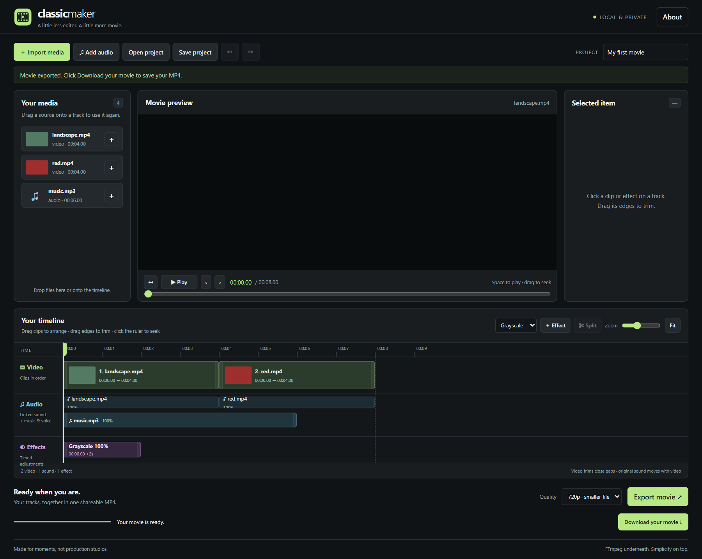

<p align="center"></p>
<h1 align="center">Classic Maker</h1>
<p align="center"><strong>A little less editor. A little more movie.</strong><br>A small, dark-by-default video editor inspired by Windows Movie Maker.</p>
<p align="center"><a href="https://github.com/nikkoxgonzales/classic-maker/releases/latest">Download</a> · <a href="docs/getting-started.md">Getting started</a> · <a href="docs/project-format.md">JSON & CLI</a> · <a href="docs/development.md">Contribute</a></p>



## Why this exists

> I'm tired of using “open source” bloatware. For non-hardcore creators like me,
> I miss Windows Movie Maker: simple, easy to install, lightweight, and it just works.
>
> — **[Nikko Gonzales](https://github.com/nikkoxgonzales)**

Classic Maker is for the little movies: a trip, a family moment, a few clips you
want to put together. It is a straightforward wrapper around **FFmpeg**, not a
production studio. Your browser is the interface; your computer does the work.

## The whole workflow

1. **Import video, music, or voice** from your computer.
2. **Video track:** drag clips into order, drag their edges to trim, split at the
   playhead, and reorder by dragging.
3. **Audio track:** each video's original sound appears as a linked strip you can
   mute or detach; music and voice recordings can be placed anywhere in the movie
   with their own volume.
4. **Effects track:** add timed Brightness, Contrast, Grayscale, or Sepia ranges
   and drag them to the exact part of the movie.
5. **Play** the full sequence with the synced playhead, then **Export movie** and
   download your MP4.

Everything has a numeric alternative to dragging, plus undo/redo (Ctrl+Z /
Ctrl+Shift+Z), split (S), and Space to play. Save a project when you want to
continue later. Your original files are never changed. No accounts, cloud
uploads, subscriptions, telemetry, or watermarks.

### Included

- Dark interface with a real three-track timeline: **Video · Audio · Effects**.
- Proportional clip blocks with thumbnails, ruler, draggable playhead, and zoom.
- Drag to reorder and place, drag edges to trim, split at the playhead, and
  per-clip volume/mute with detachable original sound.
- Independent music/voice clips with gain, mixed additively with a limiter.
- Static timed effects (brightness, contrast, grayscale, sepia) in both live
  preview and export — applied over exact movie-time ranges.
- 720p / 1080p MP4 export: H.264 video, AAC stereo audio, exact 30 fps.
- Mixed resolutions, frame rates, silent clips, and portrait video handled.
- Export progress and cancellation; editing can continue during an export.
- Plain versioned JSON projects and a scriptable CLI for people and agents.
- Undo/redo for edits; source files are never modified.

**Intentionally not included:** animations, transitions, animated effects, titles,
photos, multitrack video overlays, or a professional-grade timeline. This stays a
small, understandable editor for simple movies.

## Install & open

### Easiest: portable download

Get the ZIP for your computer from **[Releases](https://github.com/nikkoxgonzales/classic-maker/releases/latest)**.

- **Windows x64:** extract the whole ZIP; open `classic-maker.exe` inside the folder.
- **macOS:** extract the ZIP; in Terminal run `./classic-maker` from the extracted folder.
- **Linux x64:** extract the ZIP; in Terminal run `chmod +x classic-maker && ./classic-maker`.

Your browser opens the editor. **Keep the launcher window open** while editing;
close it or press Ctrl+C when finished. If FFmpeg is missing, click **Set up FFmpeg**
in the editor. It downloads a verified 20–31 MB executable directly from the
imageio-ffmpeg publisher on PyPI. Internet is needed for that setup only. No Python
installation or separate FFmpeg command is needed for the portable app.

These community-built downloads are **unsigned**. Windows SmartScreen or macOS
Gatekeeper may warn; use only this repository's releases and do not disable your
system's security protections globally. [Platform details and troubleshooting →](docs/getting-started.md)

### From source: Windows, macOS, and Linux

Install [Python 3.10+](https://www.python.org/downloads/), download and extract this
repository's source ZIP, then run these commands **inside that folder**:

```sh
python -m pip install .
python -m classic_maker
```

On macOS/Linux, use `python3` if `python` is unavailable. The editor can set up
FFmpeg for you. If you prefer to install FFmpeg through pip beforehand:

```sh
python -m pip install ".[bundled]"
```

Already have FFmpeg on your PATH? No extra runtime Python dependencies are needed.
The app uses Python's standard library and plain HTML/CSS/JavaScript—no Electron,
Node runtime, frontend framework, or background cloud service.

## Automation without the UI

```sh
python -m classic_maker doctor
python -m classic_maker probe holiday.mp4
python -m classic_maker render my-movie.classic-maker.json -o my-movie.mp4
python -m classic_maker serve --no-browser --port 8765
```

`probe` and successful `render` results are JSON on stdout. Export progress and
errors go to stderr. Existing outputs require `--overwrite`; original source
clips are never overwritten, even with that flag. Relative media paths in CLI
projects resolve against the project file's directory.

[Project format, copyable examples, and local HTTP API →](docs/project-format.md)

## Things to know

- Browser preview depends on browser codec support. H.264 MP4 works best. A clip
  the browser cannot preview may still export through FFmpeg.
- Preview switches between original clips, so there can be a small loading gap;
  the exported movie is the joined sequence.
- Projects store paths and edits, **not video data**. Imported videos are copied
  into persistent local app storage. Keep those files when reopening a project.
- Imported media and exports use disk space and are not deleted automatically.
  [Storage locations and cleanup →](docs/getting-started.md#where-your-files-live)
- Encoding uses your CPU and temporary disk space. “Lightweight” describes the
  application, not the cost of video encoding.
- Source supports Windows, macOS, and Linux. See release assets and CI for the
  available portable architectures; this is not a claim that every Linux distro
  or browser has been manually tested.

## Contributing

Small, understandable improvements are welcome. Keep the simple workflow simple.
See [development & verification](docs/development.md) and
[architecture](docs/architecture.md). Report bugs with OS, FFmpeg version, steps,
and a sample you have permission to share. Don't attach private videos or project
files containing personal paths to public issues.

## License & credits

Copyright © 2026 **Nikko Gonzales**. [GPL-3.0-or-later](LICENSE); no warranty.
Your videos remain yours. FFmpeg and the packaged Python runtime retain their own
licenses; see [third-party notices](THIRD_PARTY.md).

Independent project, inspired by the simplicity of Windows Movie Maker. Not
affiliated with Microsoft.

[Changelog](docs/changelog.md)
